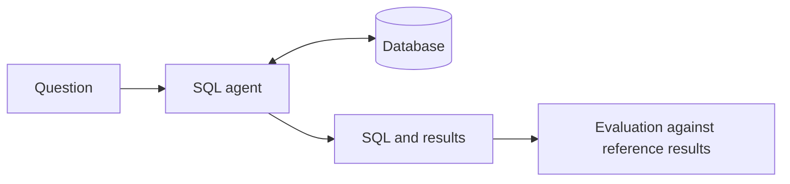

# SeaQL: A Text-to-SQL Agent with Execution-Based Evaluation

## Abstract

SeaQL is an AI-assisted database querying prototype that accepts natural-language
questions and produces SQL and database result tables. A state-based workflow
combines schema inspection, domain rules, structured generation, controlled
execution, clarification, and bounded error recovery. An evaluation framework
compares generated-query results with reference results. The initial local-model
benchmark matched 10 of 26 answerable cases after a reference correction. This
small fixed-schema result establishes a baseline, not deployed agent performance.
The API-backed agent has passed 52 offline tests and a one-question real API smoke test. Model training and model routing
are outside the agreed project scope.

## I. Introduction

Natural-language database interfaces can reduce manual SQL authoring, but generated
queries may execute successfully while computing an incorrect metric. The project
therefore treats measurable result correctness as its central objective. Users
retain visibility into the generated query and returned records.

## II. Intended Users and Requirements

The intended users are analysts and operations staff with business knowledge and
limited SQL expertise. The demonstration uses Olist e-commerce records. Inputs are
a controlled database selection and a business question. Outputs are the supporting
SQL, actual rows, and concise result explanation, or a clarification/failure message.
Database changes, if retained, require a separate reviewed execution path.

## III. System Architecture

The application consists of a browser interface, a FastAPI request layer, a
LangGraph agent workflow, an inference gateway, and SQLite access controls. The
agent uses schema metadata and documented business definitions to generate a query
or clarification. It validates statements, executes read queries and attempts
bounded correction after errors. Actual result rows support the final presentation.

A single external model API is the deployment target. The active gateway uses the NVIDIA API, and the Qdrant experiment is archived.
Local API validation does not establish a verified hosted deployment.

## IV. Methods

Direct schema inspection supplies table and column context. Explicit domain rules
address revenue, customer identity, order status, dates and aggregation grain.
Structured generation separates executable SQL from clarification. SQL parsing,
read-only SQLite connections, an authorizer and resource limits constrain ordinary
execution. State transitions handle successful execution, approval and failure.
Execution-guided repair cannot independently detect semantic errors.

## V. Evaluation

The initial set contains 26 SQL questions and four clarification cases. A separate
10-question set is reserved from training and tuning. Reference SQL supplies expected
result rows. Numeric comparisons allow documented tolerances; duplicate rows are
preserved and row order is ignored. Format and execution failures remain unsuccessful
SQL tasks. Human review assesses whether clarification addresses missing information.

The corrected initial result is 10/26 SQL tasks, or 38.5%, from direct local inference
with a pinned four-bit Qwen2.5-Coder-7B checkpoint. The original saved report contains
9/26; a Q05 reference projection correction produces the audited result. Preserve
both artifacts. Reviewed clarification outcomes are two failures and two partials.

The direct-model baseline is not an end-to-end evaluation of the revised agent.
The new run_agent_eval.py invokes the same workflow as the application, with
versioned references and failure accounting. Its full 30-case run is pending.

## VI. Limitations

The initial benchmark is small and schema-specific. Its questions were inspected
during development and are not an independent final test. Result equivalence on one
database does not prove general query equivalence. No complete hallucination-rate,
hosted application accuracy, training benefit or routing benefit is established.
The active SQLite path is consolidated. Shared-host authentication, persistence,
packaging and test repairs are prerequisites to a verified shared deployment.

## VII. Completion Criteria

Completion requires a coherent single-model application, aligned browser/backend
contracts, passing offline regression checks, an evaluation runner over the actual
agent, reviewed final cases, reproducible result records and an observed hosted
question-to-result workflow. No fine-tuning or multi-model extension is required.

## Supporting Documents

- [Architecture and current structure](docs/SYSTEM_OVERVIEW.md)
- [Evaluation protocol](eval/README.md)
- [Evaluation results and limitations](docs/EVALUATION.md)
- [Dataset provenance](DATABASE_SOURCE.md)
