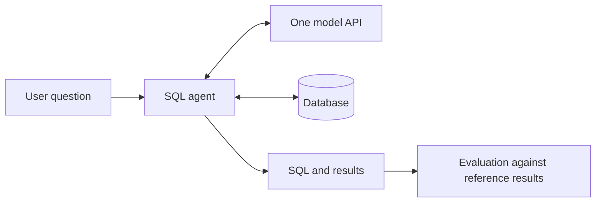

# SeaQL

**A text-to-SQL agent with execution-based evaluation for SQLite and CSV data.**

SeaQL helps analysts and operations staff ask business questions without manually
writing every query. It shows the generated SQL, actual database results and any
clarification or execution failure. Its evaluation framework distinguishes a query
that runs from one that returns the required answer.

## Architecture



The FastAPI application uses a LangGraph workflow, direct schema inspection, shared
business rules, one NVIDIA-hosted model, SQL parsing and bounded SQLite execution.
CSV uploads become queryable SQLite tables. No model weights, Qdrant or GPU are
required by the web application. Caching is disabled.

## Run locally

Python 3.12 is the supported deployment version. For a fresh installation:

```bash
python3.12 -m venv .venv-backend
.venv-backend/bin/python -m pip install -r requirements.lock.txt
```

Set `NVIDIA_API_KEY` in your shell environment or a local, untracked `.env` file. Then run:

```bash
.venv-backend/bin/python -m uvicorn app:app --host 127.0.0.1 --port 8000
```

Open `http://127.0.0.1:8000`. Choose **A database file on my computer**, upload a CSV
or SQLite file, then continue and connect. The bundled sample is `data/chinook.db`.
The local Olist evaluation database remains `olist.sqlite` at the repository root;
it is not distributed with the source.

## Evaluate

These commands intentionally call the configured external model and consume its quota:

```bash
.venv-backend/bin/python eval/run_agent_eval.py
.venv-backend/bin/python eval/run_agent_eval.py --suite holdout
```

Each case calls the same agent as the web API. Reports are saved after every case
to new files under `artifacts/agent_eval/`. The reserved suite has already been run;
keep its first result rather than repeatedly tuning against it.

Offline verification requires no model calls:

```bash
.venv-backend/bin/python -m pytest -q
node tests/ui_smoke.js
.venv-backend/bin/python eval/run_agent_eval.py --validate-only
```

## Results

| Measurement | Result | Interpretation |
| --- | --- | --- |
| First agent development run | 12/26 correct, 46.2% | Baseline on development questions |
| Revised development run | 19/26 correct, 73.1% | +26.9 percentage points; one SQL case and clarification behavior regressed |
| Reserved final SQL tasks | 3/8 correct, 37.5% | Limited generalization on new tasks in the same database |
| Offline verification | 54 backend tests; 97 interface checks | Software checks, not model-accuracy measurements |

SQL execution succeeded on 25/26 revised development cases and 6/8 reserved SQL
cases. Neither execution success nor the development score establishes reliable
business answers. [Full methodology and results](docs/EVALUATION.md) explain the
strict result comparison, clarification review and failure categories.

## Repository

```text
app.py                     Render-compatible ASGI entry point
seaql/                     Application, agent, model, ingestion and database components
static/                    Modular browser interface, charts and result grid
eval/                     Datasets, reference queries, comparator and agent evaluator
tests/                    Offline backend tests and interface checks
data/                     Licensed sample database
docs/                     Technical report, evaluation and dataset provenance
```

## Deployment and limits

Render can build the repository Dockerfile or run `uvicorn app:app --host 0.0.0.0
--port $PORT` after installing the locked requirements. Set the NVIDIA key in the
hosting service's environment settings. Uploads on free ephemeral hosting disappear
on restart or redeployment; reconnect after re-uploading. A Docker build and current
hosted release have not been verified by the local test suite.

The application is an organized, tested demonstration, not a fully hardened shared
service. It has no authenticated user isolation or database allowlist. Approval
state is process-local. Use trusted data and restricted access. External models
receive questions and schema context. Do not use confidential data without an
appropriate provider agreement. No custom model training, model routing, autonomous
learning or comprehensive hallucination-rate claim is made.

## Documentation

- [Technical report: purpose, components, workflow, design and deployment](docs/TECHNICAL_REPORT.md)
- [Evaluation protocol, results and limitations](docs/EVALUATION.md)
- [Datasets and licensing](docs/DATASETS.md)

Application code is MIT licensed. Dataset rights are separate; the bundled sample
notice is in [data/CHINOOK_LICENSE.md](data/CHINOOK_LICENSE.md).
