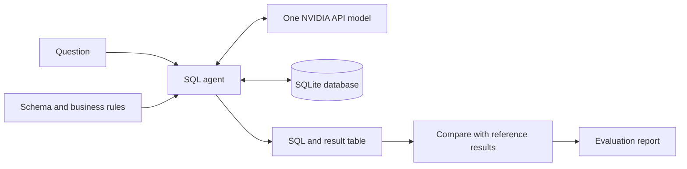

# SeaQL — Text-to-SQL Agent Evaluation

SeaQL turns questions about a SQLite database into SQL and actual result tables.
It is intended for analysts and operations staff who understand their business
questions but do not want to write every query manually. Its evaluation framework
measures whether results are correct, rather than treating executable SQL as correct.

## Architecture



FastAPI calls the LangGraph agent. The agent reads schema directly, supplies explicit
business rules, and asks one configured model for SQL or clarification. Parsed read
queries execute through read-only SQLite connections with time and row limits.
Failures can trigger up to three failed attempts. Final answers format actual values;
no second model is needed for summarization. Qdrant, embeddings, model weights and
GPUs are not required by this application path. Caching is disabled.

## Run the agent evaluation

The prepared `.venv-backend` and root `olist.sqlite` are required. Configure the
existing `NVIDIA_API_KEY` in `.env`; `.env.template` lists optional settings.

```bash
.venv-backend/bin/python eval/run_agent_eval.py
```

This intentionally calls the model API using the same `run_agent` entry point as
`/chat`. It evaluates 26 SQL questions and four clarification cases. Reports save
after every case under `artifacts/agent_eval/`, with a new timestamped filename.
Provider failure stops the run and marks it incomplete. Clarification and unsupported
business assumptions require review; they are not automatically awarded correctness.
The ten reserved final questions are not used in this run.

No-cost checks:

```bash
.venv-backend/bin/python -m pytest -q
.venv-backend/bin/python eval/run_agent_eval.py --validate-only
```

Run the web application:

```bash
.venv-backend/bin/python -m uvicorn app:app --host 127.0.0.1 --port 8000
```

Use `sqlite:///olist.sqlite` as the database selection. No file upload is needed.
The API key stays on the server. `/health` reports configuration without making a
model call. For a fresh Python 3.12 environment, install `requirements.lock.txt`;
that file records the tested complete dependency set, including test dependencies.

## CSV uploads

Choose **SQLite / CSV (My Computer)**, upload a UTF-8 comma-separated file with a
header row, then click **Connect & Save**. Each CSV becomes one SQLite table named
after the filename; the upload message shows the table name and row count. Numeric
columns are inferred, leading-zero identifiers remain text, and empty cells become
NULL. Duplicate/empty headers, inconsistent field counts and malformed CSV are
rejected. The streaming importer supports up to 200 columns and 1,000,000 rows,
subject to the configured upload-byte limit. It uses only Python's standard library.
CSV queries use generic schema rules; Olist-specific rules remain for the Olist schema.

This support is included in the standard Docker deployment. On Render Free, uploaded
files still disappear on service restart/spin-down/redeploy; CSV support does not add
persistent hosting storage. Re-upload when needed. No model files are included.

## Verification and limits

50 offline tests passed, 26 reference queries validated, and one real API-backed
agent question matched its reference result. This smoke test is not an accuracy
benchmark. The previous local Qwen baseline scored **10/26 (38.5%)** after an audited
reference correction; it is a different model and evaluation path.

The agent evaluator measures application workflow latency, not hosted browser/HTTP
latency. This checkout has not been verified as a live deployment. It remains a
controlled demonstration: no user authentication or database allowlist is implemented,
connections are caller-supplied, browser tab state needs further isolation, and write
approvals are process-local. Use trusted databases and private access. The source
Olist database is protected from writes through the executor. Uploaded files must
be validated SQLite and fit the configurable size limit. Runtime files on a free
host may be ephemeral; persistent hosting remains a separate unverified step.

Model training, fine-tuning, specialist model routing and automatic learning are
outside scope. Optional local-model scripts remain for reproducing the original
experiment. Old Qdrant, Snowflake and unused persistence experiments are preserved
under `archive/legacy/` and excluded from the active tests and container.

## Documentation

- [System definition, users, processing and structure](docs/SYSTEM_OVERVIEW.md)
- [IEEE-style technical description](IEEE_Documentation.md)
- [Evaluation protocol](eval/README.md)
- [Evaluation results and limitations](docs/EVALUATION.md)
- [Database provenance](DATABASE_SOURCE.md)
- [Initial questions](business_questions.md)
- [Reserved final questions](final_holdout_questions.md)
