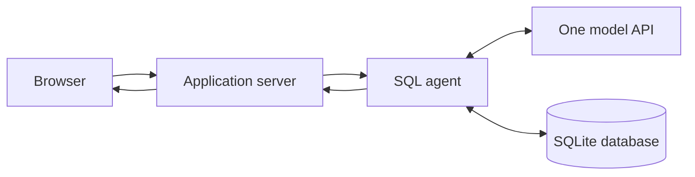
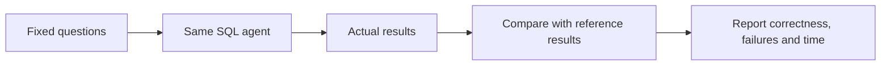

# System definition and architecture

## 1. System definition

SeaQL is an AI-assisted database analysis prototype. It translates natural-language
questions into SQL, executes controlled queries, and presents the resulting records.
Its evaluation framework measures whether those records answer a defined question
correctly. Execution success and answer correctness are separate measurements.

The system supports analytical decision-making; a plausible generated answer is
not evidence until checked against the database and question semantics.

## 2. Users and application domain

Primary users are business analysts and operations staff. Developers use the SQL,
results, and evaluation records to inspect reliability. Olist supplies the initial
e-commerce domain: orders, customers, sellers, items, payments, reviews, delivery
and marketing leads. The initial release should support this controlled SQLite
scenario rather than advertise unverified multi-database or enterprise capabilities.

## 3. Functional requirements

The system accepts a SQLite database or uploaded CSV and a question. A CSV is validated and converted into a SQLite table before schema inspection. It should obtain
actual schema context, apply documented business meanings, and produce SQL or a
clarification. Ordinary queries must be read-only, single-statement and bounded.
Execution failures may trigger bounded repair. Missing costs, undefined segments,
or unanchored historical periods must not be resolved by inventing facts.

Successful output contains SQL, actual rows and a concise explanation. Failure
output explains that no valid result was produced. Truncated results are identified.
If write approvals remain, they form a separate controlled demonstration on working
copies, not permission to modify the source dataset.

## 4. Application connections

This is the target deployed connection pattern. Model inference is performed by an
external API provider. Model weights do not need to run on the web host.

The schema and business rules are supplied to the agent; only the context needed
for the request is sent to the provider. The agent does not train on the database
when answering a question. API credentials remain server-side.

### Step 1 — Receive the question

The browser submits the question and selected connection. FastAPI validates the
request and invokes the application workflow. The current API accepts raw connection
URIs; cleanup should align it with a controlled Olist connection and honest scope.

### Step 2 — Inspect schema and apply business meaning

The revised execution layer inspects SQLite table and column metadata directly.
Full schema context is appropriate for the small demonstration and avoids losing
join tables through incomplete semantic retrieval. Explicit business definitions
specify revenue, buyer identity, order scope, dates and aggregation grain.

### Step 3 — Generate SQL or clarification

One configured language model receives the question, schema and business rules.
Structured output distinguishes SQL from a request for missing information. This
is task interpretation by one model, not routing between specialist models.

### Step 4 — Validate and execute

The revised layer uses SQLGlot to parse one supported statement. SQLite read-only
connections and an authorizer restrict ordinary execution. Runtime and row limits
bound the workload. Parser acceptance does not prove business correctness.

### Step 5 — Correct execution failures

LangGraph carries query state and selects the next processing step. A failed query
and its error are supplied for repair; at most three failed attempts are allowed.
A valid but semantically incorrect aggregation may not raise an error and therefore
requires evaluation rather than execution-error repair.

### Step 6 — Present evidence

The revised agent formats actual database values deterministically. The browser
shows SQL and a results table, and can chart suitable two-column results. This avoids
using another generation step to invent an explanation of the returned data.

## 5. Evaluation connections

`eval/run_agent_eval.py` now invokes the same application agent. The historical
`run_local_baseline.py` remains a separate direct-model experiment.

Reference queries define expected rows before candidate testing. Comparisons retain
duplicates and column order; the existing comparator ignores row order and allows
small numeric tolerances. Consequently its score does not establish ordering
correctness or general SQL equivalence across databases.

SQL execution accuracy uses every answerable case as its denominator, including
failed generations and executions. Also report execution success, format failures,
repair outcomes, latency and clarification behavior. Schema invention and unsupported
business assumptions need explicit labels, not an undocumented general
"hallucination score". Provider failures are recorded separately while still counting
as unsuccessful end-to-end tasks.

## 6. Current repository structure

| Area | Files | Responsibility and present status |
| --- | --- | --- |
| Web application | app.py, static/ | Interface and API with direct schema inspection; approvals remain process-local. |
| Agent | agent.py | Single-model LangGraph workflow; covered by offline and one real API smoke test. |
| CSV ingestion | csv_import.py | Streaming CSV validation, type inference and conversion to a queryable SQLite table. |
| Database operations | tools.py | Revised SQLite schema, parsing and bounded execution. |
| Business context | business_policy.py | Domain rules supplied to generation. |
| Inference/configuration | model_gateway.py, settings.py | NVIDIA API gateway and project-relative configuration. |
| Historical persistence | archive/legacy/runtime_store.py | Unused experiment, outside the active application. |
| Historical retrieval | archive/legacy/vector_store.py | Archived Qdrant/cache experiment; not imported by the application. |
| Evaluation | eval/ | Actual-agent API evaluation, historical local baseline, references and human review. |
| Question sets | business_questions.md, final_holdout_questions.md | Initial cases and reserved final cases. |
| Local experiments | scripts/prepare_local_model.py, scripts/serve_model.py | Download/smoke test and local inference; optional for final product. |
| Verification | tests/ | 50 isolated offline tests covering graph, API, SQL controls, provider and scoring. |
| Packaging | requirements.txt, Dockerfile, ignore files | Locked tested backend dependencies; no local models or environments in container context. |
| Data/evidence | olist.sqlite, chinook.db, models/, artifacts/ | Local inputs and outputs; not application source or Git deliverables. |

The final organization should retain one application path and one primary evaluator.
Do not move files solely for visual neatness if that introduces import churn.

## 7. Deployment and project boundary

The application uses one external NVIDIA model API. Hosted execution is not yet verified. Durable request/evaluation
state must not depend on ephemeral host storage. A hosted run must be tested before
claiming deployed reliability or latency.

Fine-tuning, custom-model hosting, multi-model routing, and automatic learning are
not required. Reviewed failures can inform a documented change, followed by a
separate candidate evaluation. That is an improvement process, not online training.
