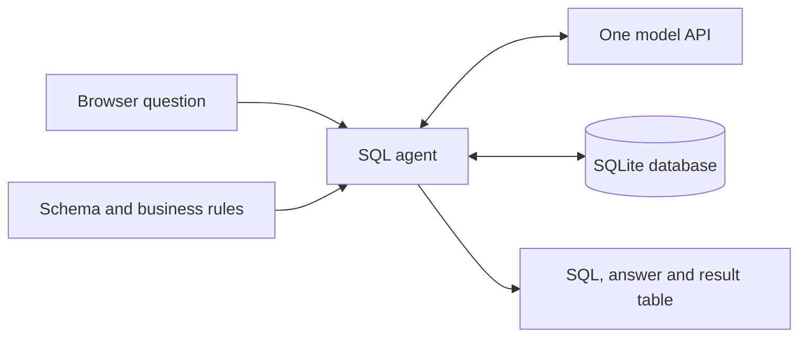
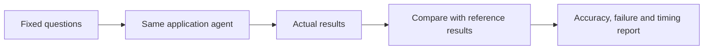

# SeaQL: Text-to-SQL Agent and Execution-Based Evaluation

## Abstract

SeaQL is a database question-answering demonstration that converts natural-language
requests into SQLite queries and presents the resulting records. It combines a
browser workspace, a FastAPI service, a LangGraph workflow, a single hosted language
model, schema inspection and constrained execution. An independent evaluation layer
compares actual result tables with reference results. Revised instructions reached
73.1% strict result accuracy on 26 development tasks, while a reserved eight-task
SQL set reached 37.5%. These results demonstrate why executable SQL and correct
business answers must be measured separately. The system is designed as an inspectable
engineering prototype; it does not claim general analytical reliability.

## 1. Problem, users and scope

Analysts often understand the information they need but must translate that question
into table joins, filters, grouping and database-specific syntax. A language model
can assist that translation, but a query can run successfully while counting the
wrong entity, weighting a metric incorrectly or applying the wrong time window.
The project addresses both query generation and the measurement of those failures.

Primary users are business analysts and operations staff working with trusted
structured data. Developers use the visible SQL and evaluation records to understand
limitations and compare versions. The intended output is an answer grounded in
actual database results, not an unsupported narrative.

The supported application scenario is SQLite, including CSV files converted into
SQLite. One NVIDIA-hosted model handles generation. Fine-tuning, hosting custom
model weights, specialist model routing, vector retrieval and automatic learning
are outside the current scope. A reviewed instruction change is ordinary development,
not a model-weight update or autonomous learning.

## 2. System boundaries

### 2.1 Inputs

The application accepts a SQLite connection URI or uploaded SQLite/CSV file, a
caller-provided tenant label and a natural-language question. CSV input requires
UTF-8 encoding, comma separation, one header row and at least one data record.

The tenant label is a logical request field, not an authenticated identity. The
application currently accepts caller-provided database paths; it does not enforce
a server-side database allowlist or authenticated workspace authorization.

### 2.2 Outputs

An ordinary successful response includes generated SQL, result rows, a concise
factual answer, model identity, attempt information and truncation status. A request
may instead produce clarification, a pending write approval or a failure explanation.
The browser exposes the SQL and results together so the user can inspect the basis
of an answer. Charts summarize supported result shapes rather than invent new data.

### 2.3 External services

Only the model API is required by the generation path. The backend does not need
Qdrant, hosted embeddings, a GPU or downloaded model weights. Model secrets are read
server-side. The request sends schema metadata, business instructions, the question
and any retry context to the provider. The ordinary generation path does not send
the complete database or execute a second model call over the result table.

## 3. Architecture

### 3.1 Application flow



The browser submits a request to FastAPI. The agent reads schema context, generates
a structured decision, validates and executes SQL, and formats actual results.
Clarification ends the workflow without execution. Errors can return to generation
within a fixed attempt budget. Data changes stop at a separate human-review gate.

### 3.2 Evaluation flow



The evaluator calls the same agent function as the web API. Reference queries are
executed independently and are never inserted into application prompts. Evaluation
is separated from visitor requests to avoid a judge call or benchmark workload for
every interaction. Report latency covers the locally invoked agent, including
network inference, not Render cold starts or browser rendering.

## 4. Repository structure and component responsibilities

```text
app.py
seaql/
    api.py              HTTP endpoints and approval lifecycle
    agent.py            LangGraph orchestration and request state
    config.py           Project-relative configuration
    model.py            NVIDIA API request and provider errors
    policy.py           Olist semantics and generic-table instructions
    database.py         Schema inspection, parsing and SQLite execution
    ingestion.py        Streaming CSV validation and conversion
    presentation.py     Query metadata and read-only impact previews
    starters.py         Schema-derived starter questions
static/
    index.html          Workspace and connection-wizard containers
    css/                Design tokens, layout and components
    js/                 API, state, chat, wizard, explorer, grid and charts
eval/
    run_agent_eval.py    Primary evaluation command
    comparison.py       Independent references and result equivalence
    olist_cases.py       Development reference queries
    holdout_cases.py     Reserved task contracts and reference queries
    datasets/           Original development and reserved questions
    results/summary.json Sanitized summaries from completed runs
tests/                  Backend regression tests and interface smoke checks
data/                   Bundled Chinook example and license notice
docs/                   This report, evaluation protocol and data provenance
```

`app.py` remains a small ASGI entry point so existing `uvicorn app:app` and Render
start commands continue to work. Implementation lives under the `seaql` package.
Local secrets, environments, downloaded assets and full experiment outputs are
excluded from Git and container builds. The large Olist database remains a local
input at the project root; it is not bundled into the deployment.

## 5. Input ingestion and schema context

### 5.1 SQLite uploads

The upload endpoint restricts extensions to `.db`, `.sqlite`, `.sqlite3` and `.csv`.
It generates a destination filename rather than trusting the client filename as a
server path. Upload bytes are read in chunks and checked against the configured
limit. SQLite uploads must open successfully and contain application tables before
the server returns a usable connection.

Incomplete or invalid files are removed from the upload directory. This validation
is not a substitute for authenticated upload ownership or a complete database
sandbox. Files are stored under the configured runtime directory; their durability
is determined by the deployment storage.

### 5.2 CSV conversion

The importer uses the Python standard library and streams the source rather than
loading the complete file into memory. A first pass validates rows and determines
column types. A second pass inserts batches of 500 rows into a generated SQLite
file. The source CSV is removed after successful conversion; the queryable SQLite
representation is retained for the session.

Headers are trimmed, checked for readable nonempty names, and required to be unique
without regard to letter case. Headers are quoted as SQL identifiers. The table
name is derived from a sanitized filename, with a safe prefix when necessary.
Empty physical lines are skipped; an empty cell becomes NULL.

Integer fields use SQLite's signed 64-bit range. Leading-zero identifiers and
out-of-range integers remain text, preventing accidental conversion of postal
codes or identifiers. Integer/real mixtures become REAL; numeric/text mixtures
become TEXT. Only finite recognized numeric strings become floating-point values.
UTF-8 byte-order marks, quoted commas and quoted newlines are supported. Dates are
not automatically reinterpreted; units and currencies are not inferred.

Limits are 200 columns, 1,000,000 data rows, a 1 MiB field parsing limit and the
configured upload-byte cap. These are resource bounds, not measured capacity or
throughput guarantees. Excel workbooks, semicolon-separated files, automatic
multi-file joins and arbitrary encodings are not supported.

### 5.3 Schema inspection

Database inspection enumerates application tables, column names, types and primary
key flags through SQLite metadata. The agent receives the full small-database schema,
which avoids omitting a required join table through top-k retrieval. Very large
schemas would require additional context budgeting; that is not evaluated here.

For a table set containing the expected Olist tables, the agent uses explicit
Olist business rules. Standalone CSV and other SQLite tables receive generic schema
instructions. This prevents a CSV from inheriting nonexistent e-commerce joins or
status filters merely because the demonstration dataset is Olist.

## 6. Agent workflow

### 6.1 Preparation

The preparation stage reads the selected schema and chooses domain or generic rules.
No model training occurs. Domain rules define buyer identity, delivered-order scope,
revenue, calendar comparisons, category translations and aggregation grain.

### 6.2 Structured generation

The model is instructed to produce either a SQL action or a clarification action.
The generation context contains business rules, schema and a general checklist for
join keys, filters, aggregation, requested output columns and ranking scope. No
reference answer rows or benchmark query identifiers enter that prompt.

The NVIDIA gateway uses configurable model and base URL settings, temperature zero
and a 1,536-token completion cap. Connection and read timeouts are 10 and 120 seconds.
The provider's observed model identifier is retained. A requested model name is not
a guarantee that the provider will keep underlying weights unchanged indefinitely.

Provider errors expose a bounded explanatory message instead of returning credential
headers or raw provider bodies. Rate-limit errors become retryable HTTP responses.
No automatic provider retry loop is layered over the SQL-repair loop.

### 6.3 Parsing and action selection

The application accepts a JSON object with either an SQL string or a nonempty
clarification question. Markdown fences can be removed before JSON parsing. Invalid
JSON, unsupported actions and SQL parser failures are recorded and may be retried.
A clarification response stops before database execution.

### 6.4 Execution-guided repair

On a query failure, the agent supplies the failed SQL and latest error to the same
model. It allows at most three failed attempts and has a graph recursion bound.
Provider failures escape this repair path and are classified separately.

Repair can fix invalid columns, syntax or aggregation usage errors. It cannot
independently recognize every valid query calculating the wrong metric. For example,
counting orders instead of unique buyers may execute without any database error.
That is the central reason for independent result-based evaluation.

### 6.5 Result presentation

Successful records are formatted deterministically. A single-row result is rendered
as named values; multiple rows receive a concise message pointing to the result grid.
Truncation is stated explicitly. A second language-model summary cannot erase a
successful result or introduce a new numerical conclusion because none is used.
This controls presentation invention but does not make incorrect SQL correct.

## 7. Database execution controls

SQLGlot parses one statement in the SQLite dialect. Reads are limited to supported
query expressions; supported insert/update/delete/create/drop/alter statements are
classified as writes. Administrative and unsupported statement types are rejected.
Read queries use an existing file in SQLite read-only mode, query-only configuration,
a restricted authorizer and disabled trusted-schema behavior. Selected file and
extension functions are denied. Missing database paths do not create empty files.

Defaults are a ten-second SQLite VM execution budget and 1,000 returned rows. A
progress callback interrupts long VM work. Results fetch one extra row to detect
truncation. These do not constitute a full operating-system memory or CPU sandbox.
Duplicate result aliases are rejected because dictionary output would lose columns.
Connections are explicitly closed; failed writes roll back.

Writes first return an approval request. The web service stores the exact SQL and
connection under a random token, with a ten-minute expiry and single-use consumption
protected by a process lock. The browser approves the token, not substitute SQL.
Rejection invalidates the token. The source Olist file is protected using file
identity, including alternate paths resolving to the same file. Approved writes
still cannot attach other databases or execute administrative PRAGMAs through the
reviewed path.

Approval state is memory-only and is not authenticated ownership. Restarting the
process invalidates pending approvals, and multiple workers do not share them.
The mechanism reduces accidental execution in a controlled demo; it is not a
complete authorization model for an untrusted shared database service.

## 8. HTTP interface

| Endpoint | Task | Result |
| --- | --- | --- |
| `GET /` | Serve the workspace | HTML interface |
| `GET /health` | Inspect application/model configuration | Configuration status; no inference call |
| `POST /upload_db` | Validate SQLite or convert CSV | Connection URI and optional imported-table metadata |
| `POST /connect` | Inspect selected database | Validated schema availability and table count |
| `POST /schema` | Fetch database structure | Tables, columns, types and key flags |
| `POST /starter_questions` | Suggest questions from schema | Starter questions without a model call |
| `POST /chat` | Run the agent | SQL/results, clarification, errors or approval token |
| `POST /run_sql` | Run edited read SQL | Bounded records and truncation; writes refused |
| `POST /preview_sql` | Inspect proposed change | Classification and read-only impact estimate where available |
| `POST /execute_approved` | Consume stored approval | Execution outcome for server-stored SQL |
| `POST /reject_approved` | Reject pending action | Invalidation acknowledgement |

Invalid inputs use structured HTTP errors. Model quota errors return HTTP 429 with
a retry hint; other provider failures return service-unavailable errors. Health is
not an availability probe of the provider: a configured key may still be expired,
rate-limited or unauthorized.

## 9. Browser components

`api.js` centralizes request handling and errors. `state.js` stores connection and
per-tab display state. `wizard.js` implements file selection and connection steps;
it allows native file selection without an OS type filter; the server validates CSV and SQLite extensions and contents. `chat.js` renders messages, editable SQL and approval
cards. `explorer.js` shows tables and columns. `datagrid.js` handles result sorting,
filtering, paging and export. `chart.js` selects supported chart shapes from result
columns. `ui.js`, `toast.js` and `icons-init.js` provide shared rendering helpers,
notifications and icons. `app.js` wires these components and API outcomes together.

Per-tab transcripts are browser-side state, not persisted server conversations.
The server's agent accepts optional history but the HTTP request does not currently
supply a full multi-turn history contract. Browser connection settings are stored
locally; a tenant label is not identity. Generic connector forms may remain from
the broader interface, but the supported executor is SQLite only.

## 10. Evaluation integration and verification

The primary evaluator invokes the same `run_agent` function used by `/chat`. Its
reference executor and comparator are separate from the application database layer.
The development and reserved suites have explicit question contracts, reference SQL
and versioned report metadata. Final reports include case statuses, raw attempts,
errors, model identifiers, timings, data/policy/source hashes and actual result rows.
Each report is saved after every case and existing reports are not overwritten.

Offline tests inject model responses while exercising the real agent graph and API.
They cover clarification, repair exhaustion, provider errors, unsupported statements,
time limits, row caps, approval replay, CSV validation and result scoring. The
interface smoke suite exercises modules against a lightweight DOM stub. It is not
an actual browser or visual accessibility audit. Model benchmarks are separate from
these software checks and consume provider quota. Cleanup does not rerun inference.

The detailed evaluation protocol, run results and interpretation are maintained in
[EVALUATION.md](EVALUATION.md), with sanitized machine-readable summaries under
`eval/results/summary.json`. Full raw reports remain local under ignored artifacts.

## 11. Configuration and dependencies

`seaql/config.py` locates the project root from its own file, loads `.env` without
overriding deployed environment variables, and reads runtime limits. The application
uses `NVIDIA_API_KEY`, optional `NVIDIA_API_BASE` and `NVIDIA_MODEL`, plus
`SQLAGENT_DATA_DIR`, `SQLAGENT_MAX_ROWS`, `SQLAGENT_QUERY_SECONDS` and
`SQLAGENT_UPLOAD_MB`. Defaults are 1,000 rows, ten seconds and 150 MiB upload bytes.

Direct dependency versions are in `requirements.txt`; development additions are in
`requirements-dev.txt`. `requirements.lock.txt` records the tested complete resolved
environment, including tests. Runtime libraries are FastAPI/Starlette, LangGraph,
SQLGlot, Requests, SQLAlchemy for URI parsing and python-dotenv. CSV parsing and
SQLite execution use the standard library. Runtime code no longer imports old
Qdrant, Snowflake, embedding or mock-model experiments.

## 12. Deployment and operational limits

The Dockerfile uses Python 3.12, installs locked dependencies, copies application
source and starts Uvicorn on the host-provided port. The ASGI entry point remains
`app:app`. Dependencies have resolved for a Linux target; a successful resolution
and offline tests are not a verified container build or hosted release.

Configure secrets in Render environment settings, not in source or frontend bundles.
The container excludes local secrets, private notes, environments, model weights,
full reports and user databases; the licensed Chinook sample is the exception.
The web host performs orchestration and SQL work while the API provider performs
model inference. Your Mac does not need to remain online for deployed inference.

Free-host local files are ephemeral. Upload-derived SQLite files and saved paths
can become invalid after restart, spin-down or redeployment. Re-uploading is the
current supported behavior. Persistent object storage/database registration,
authentication, server-side history and shared approvals are not implemented and
must not be advertised as available. Restrict access and use trusted data for this
demonstration. No uptime, cost saving, customer adoption or productivity impact has
been measured.

## 13. Design rationale and remaining limitations

Full schema inspection is simple and suitable for the evaluated small database.
A single API model keeps the deployed app lightweight. Deterministic summaries
preserve result evidence. Parsing plus database restrictions is stronger than
keyword checks, but the service still lacks a complete multi-tenant security model.
Reference-result evaluation exposes semantic failures that syntax tests cannot.

The principal measured limitation is generalization: development improvements did
not transfer reliably to the reserved tasks. Clarification also regressed while
SQL accuracy improved. These outcomes are part of the engineering findings rather
than reasons to hide failed cases or repeatedly tune the final test. The current
project demonstrates an inspectable agent and an evaluation method, not a solved
natural-language database interface.
